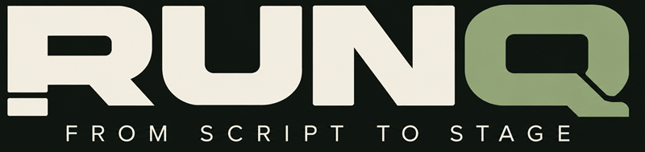

# RUNQ — From Script to Stage



**Meta Global AI Developer Hackathon 2026 · Indie developer · Build for Your World**

RUNQ is a browser-based rehearsal and sound-cue production tool. It connects a theatrical script, optional Meta Muse Spark cue suggestions, a human review process and deterministic local audio operation. AI helps prepare the show; **the operator controls GO**.

**[Watch the 2:38 demo](https://www.youtube.com/watch?v=NsFEqWO9eXs)** · **[Browse the source](https://github.com/vicentektek/showcompiler-hackathon-2026)** · **[Judge quickstart](docs/JUDGE_QUICKSTART_2026-11-03.md)**

> **Current submission source:** [`main`](https://github.com/vicentektek/showcompiler-hackathon-2026/tree/main), verified at merge commit [`35d04069`](https://github.com/vicentektek/showcompiler-hackathon-2026/commit/35d04069c4aa2595202b49ef101d1cf30d77273b) (4 November 2026), including the seven focused safety fixes in [PR #140](https://github.com/vicentektek/showcompiler-hackathon-2026/pull/140).
>
> **Project status:** publicly readable working hackathon prototype, not a certified professional show-control application. The repository is publicly accessible; an explicit software license has **not yet been chosen**, and historic security/media distribution reviews are separately documented. Public visibility must not be confused with an OSI-approved open-source license.

## Source, history and project name

**RUNQ** was initially developed under the working name **ShowCompiler**. The product was renamed as the hackathon work evolved into an integrated script, cue, rehearsal and show-operation workspace. Historical identifiers such as `.showcompiler.zip` are retained for compatibility.

The [`main`](https://github.com/vicentektek/showcompiler-hackathon-2026/tree/main) branch contains the runnable demo and the final operator-safety corrections ([PR #138](https://github.com/vicentektek/showcompiler-hackathon-2026/pull/138), [PR #140](https://github.com/vicentektek/showcompiler-hackathon-2026/pull/140)). The earlier functional baseline is [`b4e7df7`](https://github.com/vicentektek/showcompiler-hackathon-2026/commit/b4e7df724d569c1d5af7682540c206ff3fb97701), with the pre-fix submission snapshot preserved in [`release/runq-indie-submission-2026`](https://github.com/vicentektek/showcompiler-hackathon-2026/tree/release/runq-indie-submission-2026). Those preserved references are development history, **not** the current recommended build.

## What it does

| Workflow | Verified application capability |
| --- | --- |
| Script import | TXT UTF-8, text-based PDF and DOCX; preserve original content and traceable `L#` references |
| Optional Meta AI | Muse Spark proposes script-linked cues; the user reviews and approves/rejects each proposal |
| Cue preparation | Review and edit pending descriptions, labels, source evidence and voice triggers |
| Sound design | Inspect cues individually: sound idea, level in dB, fades, loop and overlap/stop-previous policy |
| Local audio | Import/assign real sound files, edit playback properties, audition and prepare cues |
| Rehearsal | Optional transcription/script following and explicitly armed Auto GO; manual GO disarms autopilot |
| Operation | NEXT/GO, individual stop/fade and STOP ALL through browser Web Audio; no inference required for transport |
| Portability | Export/import full show ZIP with audio; JSON alone does not embed media |
| Languages | English/Spanish UI and spoken-language choices; English defaults for new profiles |

**Important distinction:** Muse-derived acoustic descriptions are not the same as operator-configured numeric dB, fade, duration and overlap values. The current model proposal contract does not ship structured numeric sound-setting recommendations. RUNQ does **not** create new WAVs through Modal in the submitted application; the sound assistant prepares prompts for local audio assignment.

## Run RUNQ locally

**Prerequisites:** Node.js 20+, npm, recent Chrome or Edge, audio output. Meta credentials are optional for the manual/offline walkthrough.

```sh
git clone https://github.com/vicentektek/showcompiler-hackathon-2026.git
cd showcompiler-hackathon-2026
git switch main
# Verified hackathon merge commit: 35d04069c4aa2595202b49ef101d1cf30d77273b
npm install --no-audit --no-fund
npm run dev
```

Open **http://127.0.0.1:5173**. In Codespaces open the forwarded port 5173; do not assume a GitHub source page runs the application.

For offline validation:

```sh
npm run check:syntax
npm test
```

The final seven-fix PR #140 passed GitHub Actions **Core tests**, including browser/Chrome workflows ([run 41747150069](https://github.com/vicentektek/showcompiler-hackathon-2026/actions/runs/41747150069)), and Codex reported **843 passing offline tests**. The merged `main` tree was verified identical to the tested PR head; the merge commit did not independently trigger a new Core-tests run. A manual local smoke test of that build was also reported. These checks do **not** certify real hardware, microphone reliability, provider availability or safety-critical live operation. No paid AI requests are needed for routine offline validation.

## Five-minute walkthrough

1. Use **Try original audio demo** or import a rights-cleared TXT/PDF/DOCX script.
2. Open **Build your show / RUNQ AI**. Review pending script-linked cue proposals or create a manual cue.
3. Open **Sound design** on an approved cue; inspect gain/fades/loop/entry behavior. Saving a setting does **not** execute GO.
4. Assign a local audio file if the cue is unresolved. Check its actual duration rather than assuming a model estimate.
5. In Rehearsal, use manual control or explicitly start listening and arm Auto GO (credentials/mic required). **Manual GO disarms Auto GO** intentionally.
6. Prepare **NEXT**, execute manual **GO**, demonstrate stop/STOP ALL, and export a complete show ZIP.

For a live Meta Muse demonstration, configure the server-side `MODEL_API_KEY` according to [Meta Model API setup](docs/META_MODEL_API.md) and make an explicit request. Do not upload private scripts or show API keys in screenshots. Offline prompts and synthetic fixtures must be labelled as offline, not real model results.

## Demo and hackathon submission

- **Video:** [RUNQ — From Script to Stage (YouTube, 2:38)](https://www.youtube.com/watch?v=NsFEqWO9eXs), published 4 November 2026.
- **Repository:** [public source on GitHub](https://github.com/vicentektek/showcompiler-hackathon-2026); reviewed application SHA: `35d04069`.
- **Track/theme:** Indie Developer / Build for Your World.
- **Submission portal:** [Cerebral Valley](https://cerebralvalley.ai/e/meta-ai-developer-hackathon). The submission form and receipt are not confirmed by the repository itself.
- **Deadline:** 4 November 2026, 9:00 PM ET (5 November, 03:00 CET).
- **Licensing:** a public repository is not automatically open-source licensed. The organizer requested an open-source GitHub repository; the exact code-license terms are pending an explicit owner decision. See the security/media audit documents below.

## Submission documentation

- [Submission-day handoff (dated record; earlier visibility and SHA statements may be superseded)](docs/SUBMISSION_HANDOFF_2026-11-04.md)

- [Release notes and complete feature boundaries](docs/SUBMISSION_RELEASE_2026-11-03.md)
- [Judge installation and walkthrough](docs/JUDGE_QUICKSTART_2026-11-03.md)
- [Project description in English and draft narration](docs/SUBMISSION_COPY_2026-11-03.md)
- [Capture list and recording guidance](docs/DEMO_CAPTURE_2026-11-03.md)
- [Final verification checklist](docs/SUBMISSION_CHECKLIST_2026-11-03.md)
- [Security audit and publication conditions](docs/RELEASE_SECURITY_AUDIT_2026-11-03.md)
- [Third-party components and media-rights inventory](docs/THIRD_PARTY_AND_MEDIA_REVIEW_2026-11-03.md)
- [Feature status / future audio integration](docs/FEATURE_STATUS_AND_FUTURE_AUDIO_2026-11-03.md)
- [Dated development history and experiments](docs/DEVELOPMENT_HISTORY_INDEX_2026-11-03.md)
- [Final repository branch map, historical PRs and judge handoff](docs/REPOSITORY_HANDOFF_2026-11-03.md)
- [Approved RUNQ logo and final visual identity](docs/BRAND_IDENTITY_FINAL_2026-11-03.md)

## Technology and disclosure

Node.js local HTTP server, browser JavaScript ES modules, Web Audio, optional Meta Model API (Muse Spark), `pdfjs-dist`, `mammoth` and `libarchive.js`. The project does **not** claim a native Windows binary, PFL isolation, hardware DMX/ASIO integration, certified live-show safety, or enabled remote audio-generation deployment.

Earlier Modal SFX, Baseten evaluation, TTS, desktop and other proof-of-concept work remains in dated development documentation and Git history; it is **not** advertised as shipped. See the [archived long-form development README](docs/README_DEVELOPMENT_HISTORY_2026-11-03.md).

## Copyright and licensing

RUNQ's source is visible publicly for hackathon evaluation. **No `LICENSE` file has yet been selected for the original project code.** Until licensing is decided, do not assume that seeing the source grants broad permission to copy, modify, redistribute or commercially exploit it. GitHub's platform terms separately permit viewing and forking. Third-party dependencies and media remain subject to their own rights and licenses. This statement is a description of the current status, **not** an open-source license or a claim of compliance with any specific licensing requirement.

**RUNQ — AI helps prepare the show. The operator runs it.**
