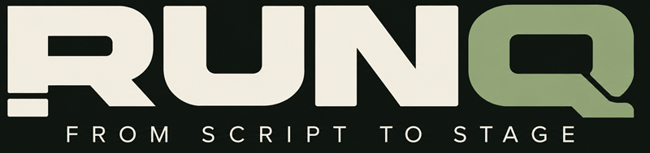

# RUNQ — Final brand identity for the 2026 submission

> **Canonical current presentation identity**, selected by the owner on 3 November 2026. This document describes the submitted visuals, not early mockups or a commitment to future product features.

## Public identity

- **Product name:** RUNQ
- **Exact approved tagline:** **FROM SCRIPT TO STAGE**
- **Product descriptor:** Intelligent Show Production Workstation
- **Engineering repository name:** `showcompiler-hackathon-2026` (historic/internal; never presented as a competing product name)
- **One-sentence positioning:** A script-linked, AI-assisted workstation for planning, reviewing, rehearsing and manually running sound cues in live shows.

## Approved artwork

The owner-approved horizontal logo already exists in the frozen source as **`assets/runq-logo-full.png`**: cream RUNQ wordmark, sage-green Q, dark backing and widely spaced uppercase tagline. **Use this existing asset**, not a newly generated substitute or an old conceptual mockup.

Recommended placements: top of the repository README, project-submission image, opening/closing video title frame and technical documentation cover. Preserve the aspect ratio and leave adequate contrast on the dark backdrop.

The separate `assets/runq-wordmark.png` and `assets/runq-q.png` exist in the repository as additional brand assets, but this does not independently establish that every variant was approved for every purpose. Avoid altering the approved horizontal artwork to make an imagined new version.

## Messaging order

1. RUNQ: **FROM SCRIPT TO STAGE**.
2. The domain: producing and rehearsing scripted live shows.
3. The operator workflow: script import → traceable cue proposals → human review → assign/edit audio → rehearsal → manual GO/STOP.
4. The Meta contribution: optional live Muse Spark interpretation of scripts and sound cues, with source evidence and explicit human review.
5. Explicit capability boundaries: sound prompts are **not** freshly generated audio files; new Modal SFX generation is disabled; model output cannot trigger manual transport; browser controller is not professional hardware-certified.

The final submission runs from `release/runq-indie-submission-2026`. The original frozen app SHA is `b4e7df724d569c1d5af7682540c206ff3fb97701`; changing captions or documentation does not modify that app.

## Accuracy and rights

This file records the owner's choice of logo and intended placement. It does **not** independently prove ownership, third-party licensing or redistribution rights of source imagery, music, sample shows or every design reference. Resolve the [media and third-party rights checklist](THIRD_PARTY_AND_MEDIA_REVIEW_2026-11-03.md) before making the repository public.

**Avoid using the former tagline “From Script to Show”** in the final application/Devpost presentation, except when preserving verbatim historic evidence.
