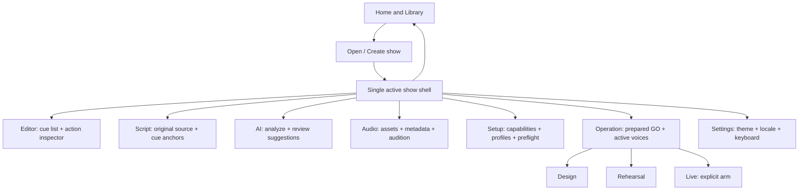
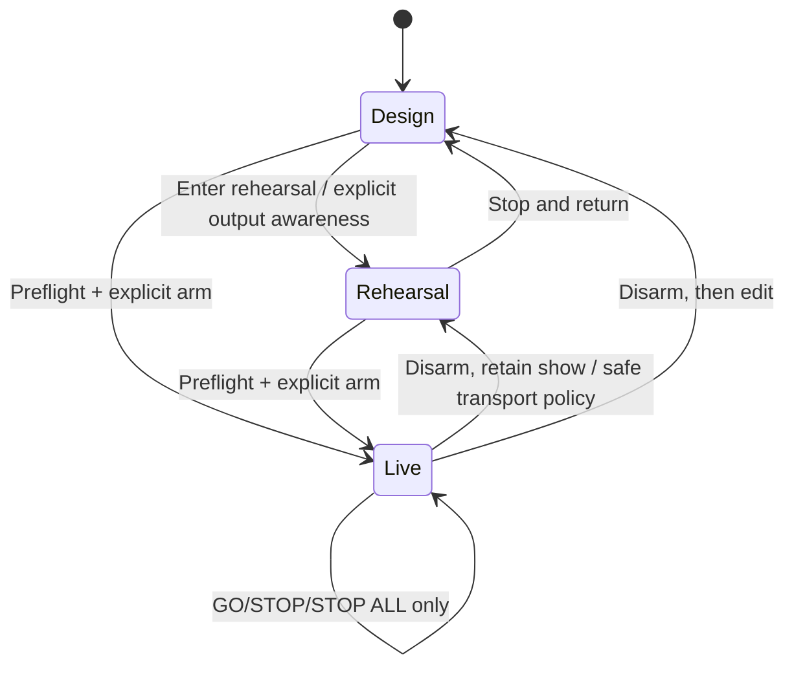

# Product UX — Professional hybrid workspace, navigation and operation states
Status: APPROVED DESIGN DIRECTION / PROPOSED ACCEPTANCE. Not evidence of shipped UI.
Date: 2026-10-27. This document contains only original, public-safe product requirements.

## Selected direction

One professional hybrid shell: focused Home/library, persistent top-level project identity, navigable workspaces for Editor, Script, AI, Audio, Setup and Operation, plus global operational modes DESIGN, REHEARSAL, LIVE. Functional workspace and operational mode are orthogonal. Theme does not determine functionality. The current browser demo is a simpler three-column prototype and should NOT be represented as this completed layout.

Principles:
- The entire application knows exactly ONE active show; title and dirty/readiness state visible in every workspace.
- **SELECTED ≠ PREPARED ≠ ACTIVE ≠ PENDING**. A cue may appear in more than one category, but the categories have distinct meanings and never collapse into a single highlight.
- No model response, script scroll, click to select, tab switch, inspector update or file import triggers GO.
- The operator can always see or immediately reach the transport. STOP ALL cannot be obscured by navigation or loading panels.
- Offline shows remain operable after project preparation even when AI providers are unavailable.
- Show properties, cue properties, underlying asset metadata and ephemeral transport state are displayed and edited in separate contexts.
- No claims of PFL/isolated headphone audition, native latency or routing beyond declared backend capabilities.

## Information architecture

The bottom mode nodes are GLOBAL shell state, not subordinate pages of Operation. Modes continue to apply while viewing Editor, Script and Audio. Home has no armed transport; exit Live through explicit safe disarm.

Menu structure: File / Edit / View / Cues / Tools / Help. Left workspace rail: Editor, Script, AI, Audio, Setup, Operation. One global project command area: Home, project identity and save status, mode selector, audio status, stop-all. Avoid duplicating a second top-level navigation system per workspace.

## Persistent shell and layout

At 1366×768, target:
- 56–64 px global header for show identity, Save/Unsaved and always-visible STOP ALL.
- 56–72 px slim navigation rail with text labels/tooltips at expanded mode.
- Editor's cue list uses PRIMARY horizontal space; inspector width approx 320–400 px, resizable. Never render the cue list as 1/3 of available width solely to force three unrelated columns simultaneously.
- Status strip for transport state, warnings and currently armed mode; less distracting during Live.
- Zoom and density switch (Compact / Standard / Spacious) without changing project data, cue selected/prepared states or playback.
- Scrolling cue list and inspector independently, with sticky cue number and live state. Optional resizable script pane and detachable script monitor.
- A read-only script auxiliary window must never receive GO ownership or change prepared cue through scroll/selection.

Visual direction: professional dark neutral Stage baseline, restrained accent colors, strong hierarchy, sparse high-salience danger emphasis only for STOP ALL, error and armed Live state. Ocean and Paper are future appearance themes. Never rely on hue alone to convey selected vs armed vs playing.

## Core state contract (UI-only unless explicitly persisted)

Persistent document:
- active show id, title, source and original assets, proposal/review data, production cues, saved audio configuration.

Session state:
- workspace (Editor/Script/AI/Audio/Setup/Operation);
- selectedCueId (inspection only);
- preparedCueId (next manual GO, separate from selection);
- activePlaybackInstances (engine-authoritative; no fake success);
- pendingGoIds and pendingAutomaticAdvances;
- stageMode (DESIGN/REHEARSAL/LIVE), liveArmed (boolean);
- selectedAssetId, selectedScriptLineId and inspector tab;
- dirty/saveState, active backend capabilities and preflight findings;
- current show generation/epoch and async request tokens.

In the current browser prototype, selectedCueId, real mode transitions, liveArmed, playback instance IDs and true workspace routing are not yet implemented. Persist only data whose meaning is stable; never serialize active sound or arm state into the show archive.

## Workspace contracts

### Home / Library

- First launch shows New show, Open full package, Open legacy JSON, Try original demo, Recent (only if genuinely saved/recoverable).
- A newly created blank show must have no fake sound cues and an unambiguous title. Do not generate the same identifier for every new user-created show; migrate legacy fixed IDs without collisions.
- Recent shows cannot be promised in a browser-only environment without a durable and consented storage plan. Avoid placeholder entries that misleadingly imply files remain on disk.
- Opening or switching show while armed or sound is active is blocked; unsaved changes prompt Save/Discard/Cancel. A failed ZIP import must not replace the current show.
- Distinguish `Save project JSON (audio not included)` from `Export portable show (audio included)`; make complete export the primary safe share command when all files exist.

### Editor

- Left: full cue list with number, label, reference L#, action icons, readiness, AUTO label if truly supported, playing status; filters and search DO NOT alter canonical cue order or GO position.
- Right: inspector for selected cue. Tabs Details / Actions / Automation / Notes / Source. If a control isn't supported, show its requirement with disabled state rather than accepting inert values.
- Buttons: Add cue, duplicate, delete, reorder, select, prepare, inspect in script. Creation of a truly manual cue requires future v2 action/evidence separation; current v1 manual mock proposals are a temporary internal demo concept.
- Source evidence displayed with links; editing label/actions must not mutate prior AI response or original script. Undo/redo actions must be safe, with separate transport history.
- For PLAY show asset, gain dB, loop/repeats, delays, fades and destination WHEN BACKEND SUPPORTS THEM. STOP/FADE targets are explicit. Show result in plain operator language.
- Keep the top-level STOP ALL while modal editor is open.

### Script

- Original script in numbered lines with search, act/scene markers and linked cue anchors.
- Click cue reference from Editor/AI to move Script to exact line; click script line to inspect cue/suggestions, NEVER to PREPARE or GO.
- Preserve source text and revision identity. A script replacement with linked cues requires explicit migration/remap plan, not silent renumbering.
- Optional separate monitor window is read-only by default. Follow-current-cue cursor and manual scroll must be independent switches.

### AI creation/review

- Import script -> choose AI analysis language AUTO or explicit hint -> show consent explaining bounded excerpt -> analyze -> grouped suggestions -> inspect original source and brief -> APPROVE / EDIT / REJECT -> apply to draft cue.
- More suggestions should NOT imply higher quality. Duplicate ambient continuation and mere dialogue mentions require human-review warnings.
- Suggestions with missing audio may be approved as unbound planning cues; they are not ready for GO.
- Support sound-generation INTENT without falsely displaying a generated WAV. Actual generation is separate and must disclose provider, copyright and usage cost.
- Existing first-party Meta integration is opt-in, bounded and server-proxied; no paid tests by default. In LIVE this area is read-only with no model calls.
- Preserve evidence/review decisions independently of subsequent production edits (future v2). Make mock/sample suggestions visibly distinguishable from actual model output.

### Audio

- Library items are source FILE assets; shows name, duration/channels when decoded, availability and what cues use them.
- Audio asset audition uses SAME master output in current browser adapter. Show a clear warning/confirmation and prohibit audition during active live output.
- Editing one cue's gain/loop is done in Editor per PLAY action, not through global asset metadata.
- Unavailable/missing assets display clear blockers and a replace/relink operation. No phantom file presence on JSON reload.

### Setup

- Explicit capabilities model: local Web Audio present; native physical routing, isolated monitor buses, multi-channel and external lighting/video devices absent until implemented.
- Complete/reduced setup is an OUTPUT PROFILE of declared available capabilities and mappings; not a magical generation of light cues and not a requirement to create sound cues.
- Optional light/video remains OFF/disabled by default. Selecting an absent target must never silently substitute master audio or another device.
- Preflight: blocker, warning and advisory; only actual blockers prevent arm/GO. Missing assets to be performed are blockers; unreviewed optional proposals are warnings, and no AI provider is not an operational blocker.

### Operation

- Primary visible target: PREPARED NEXT CUE, with number/label and source trigger. Large GO is explicitly tied to this cue alone.
- Secondary: last GO/Stop event, all active play instances, their parent cues/asset and individual STOP/FADE controls where capability exists.
- Always-visible STOP ALL stays enabled during active sound, pending resume, audition or scheduled automatic advances. Even if there are zero audible voices and a future GO is queued, STOP ALL must be actionable.
- Separate Prepare/Skip/Reset from selection. Manual cue clicks cannot silently prepare.
- GO disabled for missing audio, invalid cue, auditioning, already-pending same cue, or unarmed LIVE. Show cause close to button.
- Pending GO is NOT successful GO. Late browser resume after an operator STOP/replace must never play audio.
- Direct per-row GO buttons are allowed only if explicitly labelled as bypassing the prepared queue in DESIGN/REHEARSAL; Live should favor one authoritative prepared GO command to avoid accidental double dispatch.

## Operational mode state machine

- DESIGN: full editing, no automatic physical GO as a side effect; explicit controlled audition/manual playback tools may exist.
- REHEARSAL: manual GO, safe practice actions, opt-in voice/trigger pilot AFTER isolated testing; edits allowed only when not changing armed execution in progress. One-click reset rehearsal state must not silently delete assets.
- LIVE: explicit preflight and ARM action; project switch, risky script edits, backend device remapping, AI network actions, file load and same-output audition are prohibited. Live operation continues if network is disconnected.
- GO allowed in LIVE only when armed. STOP ALL never blocked by a pending dialog/commit, and remains responsive if UI components outside transport fail.
- DISARM while sound is active must explicitly address stop/continue policy before state changes; never silently unload media or switch project mid-play.
- No false claims that this browser MVP currently implements live arming or device safety certification.

## Keyboard and accessibility

- Space/Enter triggering GO is opt-in/active only in a clearly indicated transport focus/armed context; NEVER while typing in any input, search, textarea, modal or file dialog. Prevent browser auto-repeat duplicate GO.
- Escape is not an implicit STOP ALL because users routinely press Escape to close dialogs. STOP ALL gets a distinct shortcut requiring deliberate operator choice and visibly documented.
- Keyboard shortcuts, zoom, focus ring and text contrast should meet accessibility checks at 1366×768 and 125–150% system scaling.
- Operable with mouse/keyboard; don't require hover to find STOP or cue IDs. Convey state via text and icon as well as color.

## Navigation acceptance journeys

1. From Home create a blank show: title visible, no fake cue, mode DESIGN, Save appears unsaved; navigate Editor -> Script -> Audio and return with one active show.
2. Select cue 12 in Editor while cue 8 is PREPARED; move to Script and use search; return to Operation: next GO remains cue 8.
3. Open a proposal, jump to line L23, approve; cue enters DRAFT, asset still missing and GO stays blocked until file decoded.
4. Prepare cue 8, GO, sound plays; cue 9 becomes prepared. Return to Editor, select cue 3: current playing sound and prepared cue 9 remain unchanged.
5. Schedule hypothetical AUTO in rehearsal; STOP ALL when audio is silent but timer pending: no later GO. UI must not disable PANIC in this condition.
6. Attempt switching project while LIVE armed: blocked; DISARM through explicit procedure and handle dirty changes.
7. Export complete ZIP, close/open offline, no API key present: script/cue IDs/audio persist, manual GO works at safe output.
8. Switch EN/ES interface independently of detected script language and theme; original script IDs and cue states unchanged.
9. Play two instances of the same asset via different PLAY action identities; stopping one leaves the other unaffected (future engine).
10. With unavailable lighting/video devices, audio-only show can still be planned and operated; optional cues are disabled and disclosed.

## Implementation gates

P0 (hackathon): preserve current coherent manual sound demo, source evidence, safe STOP ALL, truthful ZIP controls and concise visible title/preflight. Integrate before any large UI rewrite.

P1 (once P0 actually works): implement shell/workspace router, selected vs prepared separation, compact Editor inspector, script deep links, safer operation view. Each separate bounded PR with interactive browser tests.

P2 (post-demo / after integration): advanced per-play action editor, modes Design/Rehearsal/Live with strong gates, home/library persistence, detachable script, repeated media routing, equipment profiles, themes, optional real providers.

P3: native device backends, validated live-grade operation, true independent headphone bus, optional external rig integrations and tested voice-following rehearsal.

## Scope labels required in implementation PRs

Every feature should be marked one of `DESIGNED`, `MODEL_ONLY`, `IMPLEMENTED_NOT_WIRED`, `DEMO_OPERABLE`, `BROWSER_TESTED`, `HARDWARE_VERIFIED`. In public-facing releases, communicate only confirmed categories and avoid conflating authoring metadata with executable behavior.
