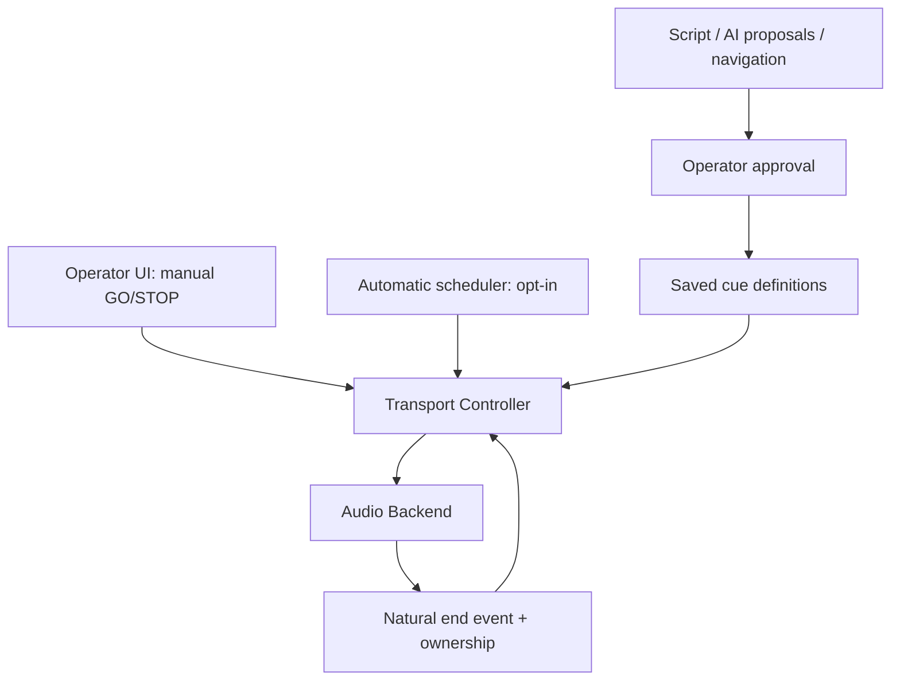

# Transport arbitration and cancellation — engineering contract
Date: 2026-10-27. Specification only; no code here is claimed as implemented.
Priority: P0 before enabling any automatic GO.

## Verified integration hazard

Today the prototype has a direct manual UI `player.go(cue)` path and `player.stopAll()` path. The separately authored automation coordinator `createCueAutomationRuntime` has independent `go(id)`, `stopCue(id)`, `endedNaturally(id)`, `cancelAll()` APIs, injectable timers and a source-keyed map of pending follow instructions. It is not connected to the browser UI.

As implemented in this unintegrated coordinator:
- `scheduleNext(sourceCueId, instruction)` stores the timer keyed by the SOURCE cue ID;
- `stopCue(sourceCueId)` removes that source's timer;
- `stopCue(targetCueId)` does not necessarily remove a timer from a *different* source that is queued to fire the target;
- its `active` set includes pending asynchronous transport.go calls, so runtime cancellation alone may not stop a late physical Web Audio start;
- native audio natural-end callback currently only identifies cueId; repeated runs need stronger run identity to reject stale completion events;
- current UI may disable STOP ALL based solely on active sounds/pending Web Audio GO/audition. If a follow is pending after sound completion, there may be nothing audible while an automatically scheduled GO remains possible.

These are demonstrated by source inspection, NOT by an integrated failing browser test. They are why optional automation MUST remain disabled until hardening is complete.

## Single owner requirement

No other code calls physical `audioBackend.go` directly once this controller exists. The controller owns a generation token and current show identity. AI, cue selection, preview focus and script links CANNOT be direct trigger sources.

## State vocabulary

For a given command:
- `PREPARED` = operator queue points to cue; no playback implied.
- `GO_QUEUED` = operator/approved automation requested GO; guard accepted an intent.
- `GO_PENDING` = async context resume, decode, permission or device setup unresolved; not audible yet.
- `SCHEDULED` = engine accepted a timestamp for a known action, not necessarily audible yet.
- `PLAYING` = live voice/instance confirmed by engine.
- `STOPPING` = fade stop has started; no new natural completion should count.
- `ENDED_NATURALLY` = all completion-barrier members finished without intentional interruption.
- `STOPPED` = deliberate stop or panic; cannot trigger AUTO_FOLLOW.
- `FAILED` = runtime exception, missing sound, invalid hardware or protected block; no auto advance.
- `CANCELLED` = invalidated before commencement. No stale completion may mutate new show state.

Controller state:
`{generation, showId, mode, armed, preparedCueId, selectedCueId, pendingGoByRunId, activeInstancesByVoiceId, pendingFollowBySourceRunId, disposed}`.

`generation` increments synchronously BEFORE silencing on STOP ALL, reset, project replacement and disposal. Each future callback, scheduled timer and pending async command checks it before invoking any external transport action or updating the active show.

## GO acceptance and terminal results

- Idempotency key: a unique intentId for each deliberate GO activation; a held keyboard key cannot produce two intents.
- Guard first checks mode/arm policy, target cue readiness, loading state, active audition and backend capability. The automated scheduler goes through the SAME guard.
- Snapshot the show generation, cue ID, action references and intended source run. A changed project invalidates the intent.
- Treat resolved `AudioContext.resume()` as only one stage. A backend GO may still be cancelled before sources.start; backend must retain its own epoch/per-cue cancellation.
- A GO request counts as successful only after all its required PLAY starts have succeeded (or accepted scheduled starts under documented semantics). Any partial-source failure stops already created voices.
- Advance the prepared pointer AFTER a confirmed successful manual GO, only if the prepared cue and generation still match. A stale response must not advance an unrelated cue.
- Automatic progression is scheduled only after successful GO (AUTO_CONTINUE) or authenticated natural completion of the specific run (AUTO_FOLLOW).
- Zero-delay follow uses a cancellable async job; never a synchronous recursive call, with chain/rate guards.

## STOP and STOP ALL semantics

### Stop one cue

`stopCue(cueId)`:
1. mark matching in-flight GO for cancellation at controller AND backend;
2. cancel auto follow timers OWNED by matching source run(s);
3. cancel pending auto next-GO entries TARGETING this cue if the operator explicitly cancels that target (a separate `cancelPendingTarget(cueId)` operation may be clearer than overloading STOP);
4. stop/fade active voices belonging to the intended run(s) without affecting other cue instances or asset reuses;
5. disarm no unrelated show and never induce natural-end follow.

Never interpret `STOP cue X` as `STOP asset of X`; that can silence another active cue using the same WAV. The UI must display what is being stopped.

### STOP ALL / PANIC

`stopAll()`:
1. synchronously increment generation; reject new auto GO until safe rearm;
2. cancel timers, microtasks via epoch fencing, voice-follow/rehearsal triggers, source/target pending follow instructions;
3. invalidate any current `AudioContext.resume`-pending GO and audition;
4. silence *all* currently active voices at backend as far as its declared capabilities permit;
5. record factual result (cancellation issued, silence attempted, backend error) — not a false success;
6. leave prepared cue pointer unchanged unless the operator explicitly resets the queue.

STOP ALL must remain ACTIVATABLE even when active audio count is zero, if *any* pending follow exists. Easiest future policy: never disable the large STOP ALL button while an active show is open. In the currently manual-only demo, an idle disabled button is less dangerous, but that logic MUST change before AUTO is active.

### Disposal and show switch

- Refuse project switch while Live armed. When authorized in Design/Rehearsal, invoke the same stopAll fencing BEFORE loading the new show.
- Staged ZIP import is side-effect-free until verification succeeds. On failure, preserve old show/audio/selection.
- Dispose old engine/coordinator and invalidate callback sources; no late onended from old engine may target cue IDs reused in a new show.

## Explicit timing contracts

- Manual GO: physical sound starts only as a consequence of explicit operator command.
- AUTO_CONTINUE: delay starts from accepted source GO; schedule next queue item once only.
- AUTO_FOLLOW: delay starts after last eligible source PLAY ends naturally. Do not confuse source.onended from `stop()` with natural completion.
- Delayed instruction's source run must still belong to current generation at fire time.
- If target is not loaded/ready or GO fails: surface error, cancel that auto chain, do NOT skip to a later cue.
- If an infinite bed is configured as blocking source: cannot AUTO_FOLLOW on its natural end. Non-blocking beds need an explicit completion-barrier design; defer if uncertain.
- Manual override of prepared next cue and automatic follow conflict must have an explicit policy: a single run owns the next GO, with duplicate-intent protection; never auto-fire a different next cue silently.

## Required deterministic hostile-race tests

| ID | Setup | Required outcome |
| --- | --- | --- |
| TR-01 | GO waiting on context resume; STOP same cue; resolve resume | source.start never occurs |
| TR-02 | GO waiting; STOP ALL; resolve resume | source.start never occurs; prepared pointer unchanged |
| TR-03 | GO waiting; switch project; same cue ID exists in new show | no stale playback or new-project state change |
| TR-04 | AUTO_CONTINUE timer queued after successful GO; STOP ALL with no active sound | no next GO; STOP ALL activatable |
| TR-05 | AUTO_FOLLOW with two voices, one naturally ends | no follow |
| TR-06 | Second voice naturally ends, repeated onended | one follow, once |
| TR-07 | Cue STOP with fade, browser fires onended | no natural completion / follow |
| TR-08 | Cue A schedules B; operator cancels queued B | B never plays; timers cancelled by target |
| TR-09 | Cue A/B share an audio asset; STOP A | B remains audible/active |
| TR-10 | Timer callback removed then invoked manually (queued microtask race) | generation fence blocks GO |
| TR-11 | Invalid target asset/backend failure on auto B | B not played, C not fired, error visible |
| TR-12 | Two rapid manual GO on same prepared cue | one accepted/one rejected; no duplicated voice |
| TR-13 | AUTO and manual GO reach same target simultaneously | one deterministic owner, at most one start |
| TR-14 | Dispose while timer pending; project reload | no stale callback or audio |
| TR-15 | Backend partial-start failure on second simultaneous PLAY | previously started first PLAY stopped/rolled back |
| TR-16 | Script search / switch workspace / edit selected cue | prepared queue and transport unchanged |
| TR-17 | Keyboard autorepeat while focus in editable field | GO never fires |
| TR-18 | Looping source with AUTO_FOLLOW | rejected/blocked; no spurious auto advance |

Test methods: injected deferred promises, fake AudioContext, synthetic onended, deterministic manual timer advancement, fake stored project/generation and minimal DOM adapter. No real time sleep, speakers, provider calls, external network or paid model tokens. Report checked *behaviors*, not just test count.

## Implementation milestones

C1: converge pending-GO cancellation + natural-end on one browser engine while keeping advanced coordinator dormant.

C1-M: human physically test explicit GO, individual STOP, fade, panic and ZIP recovery. Document output limitation.

C2a (conditional): minimal single transport command boundary for manual-only path + TR-01/TR-04/TR-12, with STOP ALL always available.

C2b (conditional): expose AUTO_CONTINUE only after timer/target cancellation and readiness tests; AUTO_FOLLOW only after run-aware natural-end and completion-barrier tests. No silent exposure of loop/fade properties.

C3+: per-instance action design and schema v2 after the event release, with real audio-capability tests.

Risk rule: if implementing AUTO exposes an unsafe backend rewrite, keep the visible manual MVP and postpone automatic fire; do not jeopardize the guaranteed safe core.
